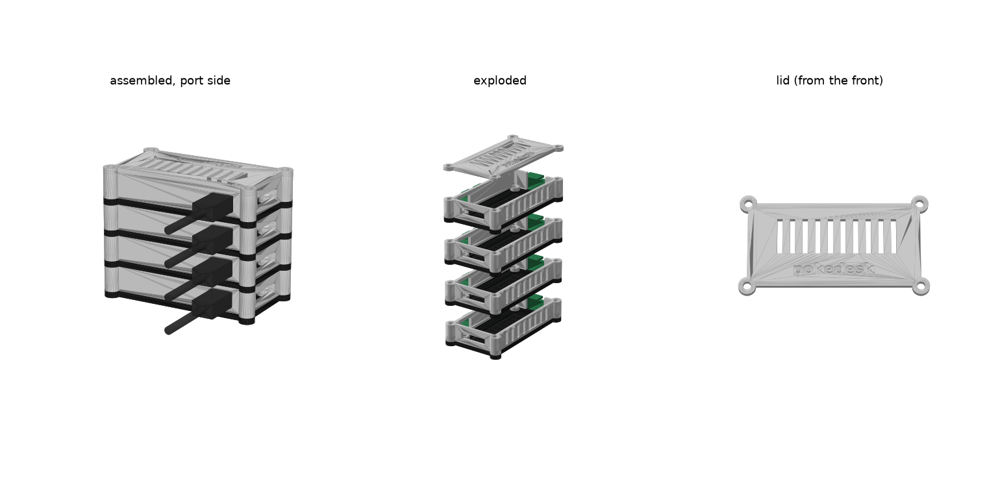

# Pi Zero tower

A 3D-printable stacking case for Raspberry Pi Zero, Zero W and Zero 2 W boards. Each Pi sits flat in its own **tray**. The trays stack into a tower with a **lid** on top, and four M3 screws clamp the whole thing together. Every tray has an opening in the port-side wall for the PWR micro-USB plug, so each Pi gets its own power cable to a USB hub **next to** the tower. The hub stays outside, which keeps its heat and bulk out of the case.



## Files

| File | Print | Notes |
|---|---|---|
| `stl/tray_white.stl` + `stl/tray_black.stl` | **one per Pi** (4 by default) | Two-colour tray: white body, black 3 mm base band. Every tray is identical. Print floor-down with no supports. |
| `stl/lid_white.stl` + `stl/lid_black.stl` | 1 | Two-colour lid: white with *pokedesk* inlaid in black (0.6 mm, the first 3 layers). Already flipped: the flat top goes on the bed. |
| `stl/tray.stl`, `stl/lid.stl` | same | Single-colour versions of the same parts. |
| `zero_tower.py` | — | Parametric source. Regenerates the STLs and `preview.png`. |

```bash
uv run zero_tower.py                 # 4 Pis, PWR opening only, 5 mm heatsink clearance
uv run zero_tower.py --pis 3         # change the stack height
uv run zero_tower.py --usb           # also open the USB/OTG data port (see below)
uv run zero_tower.py --header        # boards have a soldered GPIO header (taller trays)
uv run zero_tower.py --heatsink 0    # no heatsinks (lower trays)
```

The script prints the screw length to buy for the stack you generated. Other settings, such as clearances, wall thickness and opening sizes, are in the `P` dict at the top of the script.

## Default dimensions (4 Pis)

- Footprint is **78 × 43 mm** and the tower is **62 mm** tall (15 mm per tray).
- Each board sits on 4 mm posts with M2.5 brass heat-set inserts. There is room for a stick-on heatsink up to 5 mm tall on the SoC (recommended on a Zero 2 W).

## Bill of materials (4 Pis)

- 4× M3 × **60 mm** screws (socket or pan head). The head sits on the lid.
- 4× M3 hex nuts. Push them into the hex pockets under the **bottom** tray's columns.
- 16× **M2.5 brass heat-set inserts**, 4 mm long × 3.5 mm OD (e.g. Ruthex / CNC Kitchen M2.5 short). The posts have a 3.2 mm hole. If your inserts call for a different hole size, set `insert_hole_d` / `insert_len` in the script.
- 16× M2.5 × 5 mm machine screws (4 per Pi). Screws 5–6 mm long work; 5 mm gives 3.6 mm of thread in the insert.
- 4× micro-USB power cables, about 30 cm long. 90° plugs give the neatest result (see below).
- A powered USB hub with at least 4 ports, rated **≥ 2.5 A per Pi Zero 2 W** in total (about 10 A for 4 boards under load; idle use needs far less). A hub sold as a "charging hub" with a barrel-jack power supply works better than a bus-powered hub.
- Optional: 4 small stick-on rubber feet under the bottom tray.

## Adding more Pis later

Every tray is identical and exactly **15 mm** tall. The script rounds the tray height up to a multiple of 5 mm, so the screw length is always **15 mm × number of Pis**. The nut pockets have the same depth for every stack size, so trays you print now still fit a bigger tower later. To add a Pi, print one more tray and swap in longer M3 screws:

| Pis | 2 | 3 | 4 | 5 | 6 | 7+ |
|---|---|---|---|---|---|---|
| M3 screw | 30 mm | 45 mm | 60 mm | 75 mm | 90 mm | M3 threaded rod cut to 15 × N mm, with a nut on top |

You'll also need a free hub port for each Pi. Going above 6 is fine mechanically, but the top Pi runs warmest, so watch its temperature (`vcgencmd measure_temp`).

## Print settings

**Two colours (multi-material printer, e.g. Bambu AMS / Prusa MMU):** import each white + black pair **together** and answer **Yes** to *"load these files as a single object with multiple parts?"*. Assign white filament to the `_white` part and black to the `_black` part. Use the same material (e.g. PETG) for both colours. Each tray switches colour once, at 3 mm, so purge waste is minimal. The lid's text swaps colour on each of its first 3 layers.

PETG or ASA is best, because Zero 2 Ws in an enclosed stack run warm. PLA works if the tower is not in a hot cupboard. Use a 0.2 mm layer height, 3 walls, and 20–25% infill. No supports are needed. The plug openings and the camera slot are short bridges.

## Assembly

1. **Set the inserts (once per tray).** Put an insert on each post, narrow (tapered) end down. Press it in with a soldering iron at about 200–215 °C (PLA; press gently, it melts easily) or 245 °C (PETG/ASA), ideally with an insert tip. Push gently and straight until it sits flush with the post top, lift the iron, and hold the insert flat for a few seconds while the plastic sets. Let the tray cool before screwing into it.
2. Push 4 M3 nuts into the hex pockets under the columns of the tray you will use as the **bottom** tray. The pockets in the other trays stay empty.
3. Screw each Pi into a tray with 4 M2.5 × 5 mm screws, SD card toward the finger-notch end and the ports toward the wall with the plug opening.
4. Plug in the power cables **before** stacking. Plug into **PWR IN**, the micro-USB port nearest the corner. Then stack the trays. The columns line them up.
5. Put the lid on (its rim drops into the top tray), insert the 4 M3 screws from the top, and tighten them until the stack is snug. Don't overtighten.
6. Run the four cables down the side of the tower to the hub.

You can take the micro-SD card out of any tray without taking the stack apart. The finger notch at the SD end exposes the card edge.

## Design notes

- **Airflow** works like a chimney. Air comes in through the slots on the GPIO side and the camera-ribbon slot, rises through the slotted floor of every tray, and leaves through the lid grille. Don't put anything on the lid.
- **Cables:** the opening (12 × 8.5 mm) is sized for the moulded plastic around the plug, not just the metal connector, so the plug goes in fully. Straight plugs stick out about 25 mm from the side. **Left/right-angle 90° micro-USB cables** run flat along the wall straight down to the hub.
- **`--usb`:** with a data-capable hub, you can open the OTG port as well and run each Pi in USB-gadget Ethernet mode (`dtoverlay=dwc2`, `modules-load=dwc2,g_ether`). The hub then provides power *and* networking, so WiFi isn't needed. It's only useful if the hub connects to a host such as charmander.
- The camera-ribbon slot on the end wall also takes a CSI ribbon if you ever add a camera.
- **Board coordinates** come from the official Pi Zero mechanical drawing: mounting holes 58 × 23 mm at 3.5 mm insets, and port centres at 12.4, 41.4 and 54.0 mm. If your board's ports don't line up, adjust `port_*_x` and `plug_zc`.

## Web page

Live at **https://soumyadeep.in/pokedesk/zero-tower**. It is a print brief for whoever prints the parts: an interactive 3D viewer, the four black & white STLs, slicer loading steps and PLA settings. Hardware and assembly details stay in this README. It's a Cloudflare Worker (`deploy/`) routed on the soumyadeep.in zone, the same pattern as the other soumyadeep.in project pages. The Worker bundles `stl/*.stl` directly, so after regenerating the STLs, redeploy with:

```bash
cd deploy && npx wrangler deploy
```
